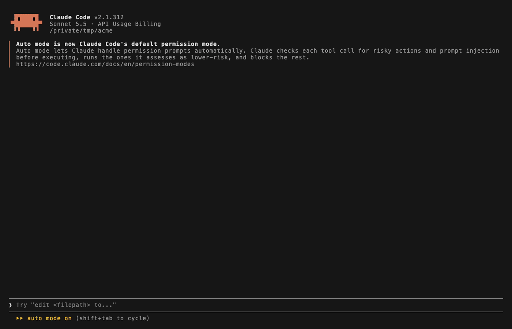

# brain

A laptop-local second brain. It indexes your Claude Code sessions, git history, GitHub pull requests, Jira tickets and Slack threads into Postgres with ParadeDB BM25 search, and answers "how did we fix this", "why did we decide that" and "what did I do on Tuesday". Haiku summarizes sessions and Slack threads; everything else is stored as written. Nothing leaves the machine except the API calls that fetch it.



Design: [docs/design.md](docs/design.md) (search, sessions, git) and [docs/design-connectors.md](docs/design-connectors.md) (connectors, events, install).

## Install

Needs Python 3.14 with [uv](https://docs.astral.sh/uv/), Docker (or an existing Postgres 18 with `pg_search`), and the `claude` CLI for summaries. The GitHub connector uses the `gh` CLI's own login.

```sh
uv run brain install
```

`install` is idempotent: it writes `~/.config/brain/brain.toml` from `src/brain/brain.example.toml`, starts the database, migrates it, prompts for connector tokens (stored in the OS keyring), schedules ingests (launchd on macOS, a systemd user timer on Linux) and links the Claude Code skill. Each step is also its own subcommand: `config`, `db-up`, `migrate`, `auth <connector>`, `schedule install`, `link-skill`. Edit `brain.toml` to enable connectors and list repos, projects and channels; see [Connectors](#connectors).

## Connectors

A connector runs when its table is present in `~/.config/brain/brain.toml` and `enabled` is not `false`. The example config ships each one commented out with its options.

| Connector | Config table | Credentials | Needs |
|---|---|---|---|
| sessions | `[connectors.sessions]` | none | Claude Code transcripts in `~/.claude/projects` |
| git | `[connectors.git]`, `roots = [...]` | none | local clones; every repo directly under each root |
| github | `[connectors.github]`, optional `repos` | the `gh` CLI's login (`gh auth login`) | `gh` |
| jira | `[connectors.jira]`, `site`, `email`, `projects` | `brain auth jira`: an [Atlassian API token](https://id.atlassian.com/manage-profile/security/api-tokens) | Jira Cloud |
| slack | `[connectors.slack]`, `user_id`, optional `channels`, `groups` | `brain auth slack`: a user token from your own Slack app (below) | a workspace that lets you install an internal app |

Tokens go to the OS keyring; `BRAIN_<NAME>_TOKEN` in the environment overrides it. After enabling one, check it with `brain ingest <connector> --dry-run`, then `brain ingest <connector>` and `brain status`. The first run reads the connector's whole window (`since_days`), so it can take a while.

### Slack app

1. At [api.slack.com/apps](https://api.slack.com/apps), choose **Create New App → From scratch** and pick your workspace.
2. Under **OAuth & Permissions → User Token Scopes**, add `search:read`, `channels:history`, `groups:history`, `im:history`, `mpim:history`, `channels:read`, `groups:read`, `im:read`, `mpim:read` and `users:read`. The app needs no bot scopes.
3. **Install to Workspace**. Some workspaces send this to an admin for approval.
4. Copy the **User OAuth Token** (`xoxp-...`) and run `brain auth slack`.

Your member id for `user_id` is under your Slack profile → **Copy member ID**.

### Writing a connector

A connector is one module in `src/brain/connectors/` with a `fetch(ctx)` generator that yields a `Record` per item (or `Failed` for one it could not read), registered in `registry()` in `connectors/__init__.py`. `brain ingest` stores, indexes and (when asked) summarizes every source the same way.

- `ref` is a stable unique id such as `jira:PROJ-123`; a record whose body has not changed is not stored or summarized again.
- `summarize = "session"` or `"slack"` asks Haiku for a title, summary and topics. Leave it unset for text already written for people, such as tickets.
- `events` lists who did what and when, for `brain events`.
- `ctx.cfg` is the connector's table from `brain.toml`; `ctx.conn` reads `connector_runs.last_success` to fetch only what changed (see `connectors/github.py`).
- Set `SECRET = True` if it needs a token from `brain auth <name>`, and add a commented-out table to `src/brain/brain.example.toml`.

[docs/design-connectors.md](docs/design-connectors.md) has the design and conventions; Claude Code can write a connector from it, using an existing one as a model.

## Use

```sh
brain search "pooler connection exhaustion" --since 90     # ranked hits; --source, --project, -n, --json
brain show <ref>                                            # one record; --topic N or --passage N for part of a session
brain events --actor me --since 1                           # what you did, across every source
brain events --to me --since 7 --json                       # what was addressed to you: mentions and DMs
brain events --ref jira:PROJ-123                            # who did what to one thing
brain status                                                # record counts and connector health
```

In Claude Code, the `brain` skill runs these for you when a question refers to earlier work.


## Ingest

The schedule runs `brain ingest` every 30 minutes; each connector reads from a little before its last success. Run one by hand with `brain ingest <connector>`. `--full` re-reads the connector's whole window, `--since N` narrows that to N days, and `--dry-run` lists what would be stored. A run of a connector that is already running is skipped.

## Develop

```sh
uv run pytest
uv run ruff check .
```

`BRAIN_CONFIG` overrides the config path and `BRAIN_DSN` the database. The retrieval eval (`eval/run_eval.py`) reads its cases and writes results under `~/.local/share/brain/eval` (`BRAIN_EVAL_DIR` overrides).
