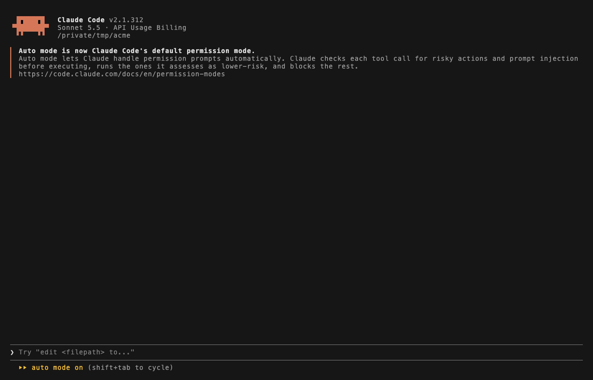

# brain

A laptop-local second brain. It indexes your Claude Code sessions, git history, GitHub pull requests, Jira tickets and Slack threads into Postgres with ParadeDB BM25 search, and answers "how did we fix this", "why did we decide that" and "what did I do on Tuesday". Haiku summarizes sessions and Slack threads; everything else is stored as written. Nothing leaves the machine except the API calls that fetch it.



Design: [docs/design.md](docs/design.md) (search, sessions, git) and [docs/design-connectors.md](docs/design-connectors.md) (connectors, events, install).

## Install

Needs Python 3.14 with [uv](https://docs.astral.sh/uv/), Docker (or an existing Postgres 18 with `pg_search`), and the `claude` CLI for summaries. The GitHub connector uses the `gh` CLI's own login.

```sh
uv run brain install
```

`install` is idempotent: it writes `~/.config/brain/brain.toml` from `src/brain/brain.example.toml`, starts the database, migrates it, prompts for connector tokens (stored in the OS keyring), schedules ingests (launchd on macOS, a systemd user timer on Linux) and links the Claude Code skill. Each step is also its own subcommand: `config`, `db-up`, `migrate`, `auth <connector>`, `schedule install`, `link-skill`. Edit `brain.toml` to enable connectors and list repos, projects and channels.

## Use

```sh
brain search "pooler connection exhaustion" --since 90     # ranked hits; --source, --project, -n, --json
brain show <ref>                                            # one record; --topic N or --passage N for part of a session
brain events --actor me --since 1                           # what you did, across every source
brain events --to me --since 7 --json                       # what was addressed to you: mentions and DMs
brain events --ref jira:PROJ-123                            # who did what to one thing
brain status                                                # record counts and connector health
```

In Claude Code, the `brain` skill runs these for you when a question refers to earlier work.


## Ingest

The schedule runs `brain ingest` every 30 minutes; each connector reads from a little before its last success. Run one by hand with `brain ingest <connector>`. `--full` re-reads the connector's whole window, `--since N` narrows that to N days, and `--dry-run` lists what would be stored. A run of a connector that is already running is skipped.

## Develop

```sh
uv run pytest
uv run ruff check .
```

`BRAIN_CONFIG` overrides the config path and `BRAIN_DSN` the database. The retrieval eval (`eval/run_eval.py`) reads its cases and writes results under `~/.local/share/brain/eval` (`BRAIN_EVAL_DIR` overrides).
